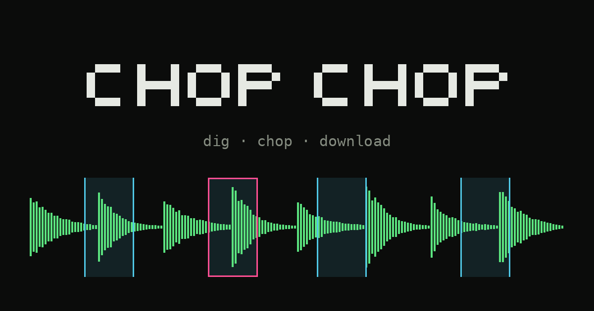

# chop chop ✂

**dig · chop · download** — pull samples from any audio, right in your browser.

**→ [chochop.vercel.app](https://chochop.vercel.app)**



chop chop is a small web tool for turning any sound into a pack of samples: load or record some audio, *dig* out a handful of slices, *chop* them into shape and *download* them as a ZIP of WAV files ready for your sampler.

Everything happens in your browser. No uploads, no accounts, no tracking — see [Privacy](#privacy).

## How it works

### 1 · Dig

Ask for something like **“8 slices of 2 s”** and hit **Dig**. Choose how to dig:

- **random** — random spots, each starting on a detected hit, without overlapping.
- **spread** — evenly spread across the whole audio, snapped to the nearest hit.
- **in a row** — back to back from the cursor (click the waveform to place it).
- **sigil** — a playful ritual: **draw a symbol** with mouse or finger and let it choose. The sub-pixel, sub-millisecond jitter of your strokes is hashed (SHA-256) into a seed that scatters 1024 random points over the audio; Dig takes the windows where they pile up most. Nothing is kept or sent.

Star ★ the slices you like and dig again: starred slices stay, the rest get replaced. Changing the seconds resizes every unstarred slice on the spot.

### 2 · Chop

- Drag the middle of a slice to move it and its edges to resize it.
- Double-click the waveform to add a slice of the chosen length; drag over an empty area to draw one by hand (hold <kbd>Alt</kbd> to draw on top of another).
- Per-slice settings: name (8 characters), mono/stereo, speed (×1, ×0.75, ×0.5, ×0.25, tape style), fade in/out, volume and reverse.
- **Volume** per slice: *Original*, *Normalized* (peak to −0.3 dBFS), *Loud* (default) or *Max*. Loud and Max push the slice into a look-ahead limiter, so quiet tails come up while peaks stay under −0.3 dBFS — closer to the level of commercial sample packs.
- **Slots are pads:** tap a slot (finger or mouse) or press its key to hear it instantly. The active bank maps to a 4×4 block of keys — `1 2 3 4` / `Q W E R` / `A S D F` / `Z X C V` — shown on each slot. Slices are pre-rendered in the background so pads respond right away.
- Listen to the original, or play all slices **in order** or **shuffled**, back to back and looping.

### 3 · Download

Give the pack a name and hit **Download ZIP**. You get a ZIP with one folder named after the pack and the 16-bit / 44.1 kHz WAV files straight inside it, each named with up to 8 characters and numbered in order (`RAIN01`, `RAIN02`…).

Choose **8, 12 or 16 slots per bank** above the slot grid to match your sampler (for example 8 for a Bastl Wave Bard, 12 for a pad group on a 12-pad sampler, 16 for a 4×4 pad grid); it sets how the slots and pad keys are grouped. The pack name also seeds the sample names (`RAIN01`, `RAIN02`…); slices you rename by hand keep their names.

The transport bar shows the total length of your slices.

## Getting audio in

- **Open** WAV, MP3, AIFF, OGG, FLAC or M4A — anything your browser can decode — or drop a file onto the page.
- **● Record**, captured as raw, uncompressed audio with the browser's voice processing (noise suppression, echo cancellation, auto gain) turned off. Leading and trailing silence is trimmed automatically; recordings are capped at 5 minutes.
  - **A browser tab** — whatever plays in another tab (YouTube, SoundCloud, Bandcamp…). Pick the tab and tick “Also share tab audio”. Desktop Chrome/Edge only. Some sites (e.g. Spotify, Netflix) block capture and only give silence; chop chop tells you when that happens.
  - **The mic** — objects, voices, the street.
  - **This computer** — everything your system plays. Share the entire screen with “Share system audio”. Works in Chrome/Edge on Windows and ChromeOS; on macOS it depends on the macOS and Chrome versions.

## Keyboard shortcuts

| Key | Action |
| --- | --- |
| <kbd>1</kbd>–<kbd>4</kbd> <kbd>Q</kbd>–<kbd>R</kbd> <kbd>A</kbd>–<kbd>F</kbd> <kbd>Z</kbd>–<kbd>V</kbd> | Play the slots of the active bank (like pads) |
| <kbd>Shift</kbd> + <kbd>D</kbd> | Dig |
| <kbd>K</kbd> | Star / unstar the selected slice |
| <kbd>Space</kbd> | Play / stop |
| <kbd>Delete</kbd> / <kbd>Backspace</kbd> | Remove the selected slice |
| <kbd>←</kbd> <kbd>→</kbd> | Previous / next slice |
| <kbd>Esc</kbd> | Deselect |
| Wheel | Zoom · <kbd>Shift</kbd> + wheel: scroll |
| Double-click | Add a slice of the chosen length |

## Languages

The interface is available in **Español**, **Galego** and **English** (switch at the top right; the choice is remembered, and the first visit follows your browser language).

## Browser support

Made for desktop browsers. Editing, listening and downloading use standard Web Audio and should work in current Chrome, Edge, Firefox and Safari (it's mainly tested in Chrome). Recording a tab or the system audio needs desktop Chrome or Edge; recording the mic works wherever the browser allows microphone access.

## Example: loading a pack into a Bastl Wave Bard

1. Download the ZIP and unzip it.
2. Open the [Bastl sample loader](https://apps.bastl-instruments.com/wave-bard-sample-loader/) and drag the WAVs into a bank, 8 at a time.
3. Click “Generate firmware file” and copy the `.uf2` to the Wave Bard in boot mode (hold SHIFT while powering it over USB).

Tip: tune melodic samples to C so the Bard's scales line up.

## Privacy

chop chop **collects no data**. Your audio and recordings are processed only in your browser and are never uploaded anywhere. No accounts, no cookies, no analytics, no ads.

This is enforced, not just promised:

- The site is served with a strict **Content-Security-Policy** (see [`vercel.json`](vercel.json)) including `connect-src 'none'`, so the browser refuses any outgoing connection from the page. You can check it in your browser's developer tools.
- Fonts are self-hosted; the page loads nothing from third parties.
- `Referrer-Policy: no-referrer`, and a `Permissions-Policy` that only allows the microphone and screen capture for the site itself.
- The only things stored, in your own browser, are your language and whether to show the help on arrival.

Like any website, the hosting provider (Vercel) keeps technical request logs (such as IP addresses) for a limited time.

## Development

There is no build step and no dependencies: plain HTML, CSS and JavaScript modules.

```sh
python3 tools/serve.py
# open http://localhost:8000
```

`tools/serve.py` serves the site with the same security headers as production, read from `vercel.json`, so anything that would break under the Content-Security-Policy breaks locally too. (Opening `index.html` directly from disk won't work, because ES modules need a server.)

### Project layout

| Path | What it is |
| --- | --- |
| `index.html`, `style.css` | Interface |
| `app.js` | Editor, dig, recording, playback, rendering (`OfflineAudioContext`) and ZIP export |
| `dsp.js` | Pure functions: hit detection, dig, WAV and ZIP encoding, names, memory budget |
| `rec-worklet.js` | AudioWorklet that captures raw audio while recording |
| `i18n.js` | All interface text in es / gl / en |
| `fonts.css`, `fonts/` | Self-hosted fonts (SIL Open Font License, see [`fonts/README.md`](fonts/README.md)) |
| `favicon.svg`, `icon-*.png`, `og.png`, `site.webmanifest` | Icons, share image and web app manifest |
| `vercel.json` | Hosting config and security headers |
| `tools/serve.py` | Local server with production headers |

### Deployment

The site is hosted on Vercel and deploys automatically on every push to `main`.

## Contributing

Ideas, bug reports, translations and code are welcome — see [CONTRIBUTING.md](CONTRIBUTING.md).

## License

[MIT](LICENSE) © 2026 **StreetShark123**. You're free to use, copy, modify and share it, including commercially, as long as you keep the copyright notice and license.

The fonts in `fonts/` are distributed under the SIL Open Font License 1.1.

The name **chop chop** identifies the original project by StreetShark123. If you publish your own version, please give it a different name.
